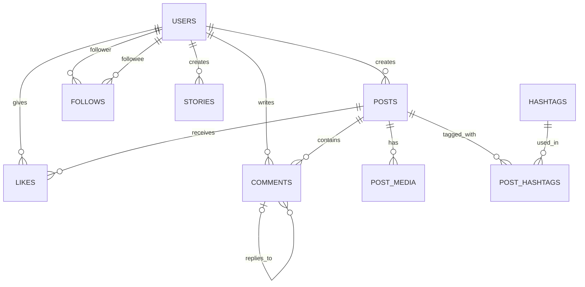

# Instagram Database - Schema Design

## 1. Database Overview

The database is designed using PostgreSQL and contains nine relational tables under the `instagram` schema.

The design maintains referential integrity using primary keys, foreign keys, unique constraints, NOT NULL constraints and CHECK constraints.

## 2. Tables and Primary Keys

| Table | Primary Key |
|---|---|
| users | user_id |
| follows | follower_id, followee_id |
| hashtags | hashtag_id |
| posts | post_id |
| post_hashtags | post_id, hashtag_id |
| post_media | post_id, position |
| likes | user_id, post_id |
| comments | comment_id |
| stories | story_id |

## 3. Relationships and Cardinality

1. Users to Posts: One-to-Many. A user can create multiple posts.
2. Users to Follows: One-to-Many as follower and one-to-many as followee.
3. Posts to Likes: One-to-Many. A post can receive multiple likes.
4. Users to Likes: One-to-Many. A user can like multiple posts.
5. Posts to Comments: One-to-Many. A post can have multiple comments.
6. Users to Comments: One-to-Many. A user can write multiple comments.
7. Comments to Comments: One-to-Many self-referencing relationship for replies.
8. Posts to Hashtags: Many-to-Many through post_hashtags.
9. Posts to Post_Media: One-to-Many. A post can contain multiple media items.
10. Users to Stories: One-to-Many. A user can create multiple stories.

## 4. ER Diagram (Mermaid Source)

## 5. Normalization Analysis

### First Normal Form (1NF)
All tables contain atomic values. Each table has a primary key, and repeating groups are avoided.

### Second Normal Form (2NF)
All tables are in 1NF. Tables with composite primary keys do not contain non-key attributes that depend on only part of the key.

### Third Normal Form (3NF)
All tables are designed to avoid transitive dependencies among non-key attributes.

## 6. Functional Dependencies

- users: user_id -> all other user attributes.
- follows: (follower_id, followee_id) -> status, created_at.
- hashtags: hashtag_id -> tag.
- posts: post_id -> all other post attributes.
- post_hashtags: (post_id, hashtag_id) identifies each mapping.
- post_media: (post_id, position) -> media attributes.
- likes: (user_id, post_id) -> created_at.
- comments: comment_id -> all other comment attributes.
- stories: story_id -> all other story attributes.

## 7. Derived and Redundant Attributes

- users.followers_count: Can be calculated by counting accepted follower relationships.
- users.following_count: Can be calculated by counting accepted following relationships.
- posts.like_count: Can be calculated by counting likes for a post.
- posts.comment_count: Can be calculated by counting comments for a post.
- stories.expires_at: May be derived from created_at if a fixed expiry duration is used.

These values are stored to make common reads easier. They must be maintained consistently when related records change.

## 8. Referential Integrity and Constraints

- Primary keys uniquely identify records.
- Foreign keys maintain relationships.
- UNIQUE constraints prevent duplicate usernames, emails and hashtags.
- NOT NULL constraints enforce mandatory attributes.
- CHECK constraints validate account types, post types, media types and non-negative counts.
- ON DELETE CASCADE removes dependent records.
- ON DELETE SET NULL handles deleted parent comments.

## 9. Data Loading Summary

| Table | Expected Rows | Loaded Rows |
|---|---:|---:|
| users | 30,000 | 30,000 |
| follows | 258,588 | 258,588 |
| hashtags | 50 | 50 |
| posts | 60,000 | 60,000 |
| post_hashtags | 150,000 | 150,000 |
| post_media | 89,854 | 89,854 |
| likes | 419,954 | 419,954 |
| comments | 150,000 | 150,000 |
| stories | 40,000 | 40,000 |
| **Total** | **1,308,446** | **1,308,446** |

## 10. Integrity Check Results

| Integrity Check | Violations |
|---|---:|
| Self follows | 0 |
| Posts without valid users | 0 |
| Comments with missing parent | 0 |
| Stories with invalid expiry | 0 |

All four checks returned zero violations.

## 11. Conclusion

The Instagram database contains nine tables with primary keys, foreign keys and validation constraints.

All 1,308,446 records were loaded successfully, and the integrity checks returned zero violations.

The schema provides a consistent relational foundation for subsequent query and performance analysis phases.
